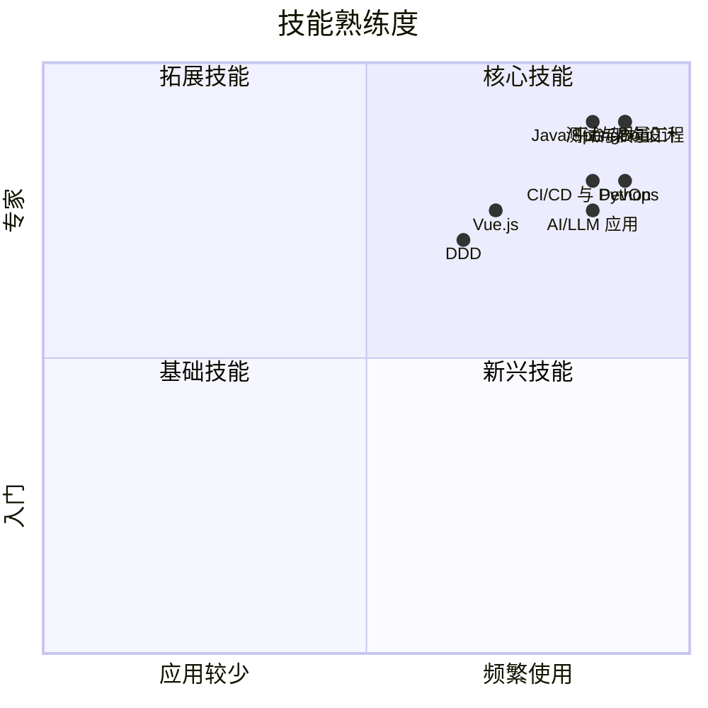

# 关于我

> 一个开发人的自我修养 | 技术育儿实践者 | 终身学习者

## 👨‍💻 我是谁

**孙荣（Mr.Sun）**，平台研发工程师，AI Agent 实践者，程序员爸爸。

- 📍 **坐标**：上海
- 🎓 **专业**：计算机科学与技术
- 📧 **邮箱**：sunrong1990@126.com

## 🧠 我关注什么

**把 AI Agent 真正用进日常研发，而不只是调 API。**

我在测试工具与平台方向做了十一年。这个领域教会我一件事——**系统能不能落地，取决于它是否可观测、可干预、可闭环**。现在我把同一套方法论搬到 AI Agent 上：让 Agent 从 demo 变成能长期跑的生产系统。

- **AI Agent 工程化**：从 0 到 1 搭建部门级 Agent 平台，把 AI 代码占比从 10% 推到 70%
- **质量与可观测**：决策链路追踪、Token 成本监控、BadCase 归因告警
- **开源社区**：AgentScope 上游贡献者（9 个 PR + 9 个 Issue，其中 2 个 PR 已合并主干）
- **写作**：150+ 篇技术博客，写 AI Agent、研发效能、职场成长和育儿

## 🛠️ 技能图谱

### 核心能力

| 领域 | 技能 | 熟练度 |
|------|------|--------|
| **架构设计** | 平台架构、微服务、DDD | ⭐⭐⭐⭐⭐ |
| **测试与质量** | 自动化测试、性能测试、可靠性测试 | ⭐⭐⭐⭐⭐ |
| **AI 应用** | AI Agent、大模型应用、Prompt 工程 | ⭐⭐⭐⭐⭐ |
| **编程语言** | Java, Python, JavaScript/TypeScript | ⭐⭐⭐⭐ |
| **DevOps** | Jenkins, GitLab CI, Docker, K8s | ⭐⭐⭐⭐ |
| **前端开发** | Vue.js | ⭐⭐⭐ |

## 📦 内容与作品

### 博客

**150+ 篇文章**，主要分布在四个方向：

| 方向 | 篇数 | 说明 |
|------|------|------|
| **AI 实践** | 86 | Agent 架构、源码精读、工具链实战 |
| **学习洞见** | 28 | 元认知、心流、学习方法论 |
| **职场成长** | 16 | 研发效能、晋升与协作 |
| **育儿心得** | 9 | 陪 Max 做 STEM 课程记录 |

**代表文章：**

- [Claude Code 架构精读：从 30 行循环到独立判断器](/posts/ai-practice/2026-10-08-claude-code-architecture.html)
- [Vibe Coding 学习源码的方法论：四层索引 + 并行扫描](/posts/ai-practice/vibe-coding/ai-agent-source-code-learning-methodology.html)
- [DDD 架构模式：从整洁架构到六边形架构的统一视角](/posts/ai-practice/2026-09-27-ddd-architecture-patterns.html)
- [悦纳自己：从反 PUA 到心理韧性，一堂心理学课的完整笔记](/posts/learning/insights/悦纳自己-从反PUA到心理韧性-心理学讲座笔记.html)
- [上海程序员通勤实录：每天 3 小时，我是如何利用的](/posts/career/huawei-experience/commute-learning-3hours.html)

### 开源与技术栈

- **AgentScope 上游贡献者** —— 9 个 PR + 9 个 Issue，覆盖 formatter / model / tool / rag / state / agent 六大模块
- **技术栈详情**：[tech-stack](/posts/career/tech-stack.html) · [项目作品](/posts/career/projects.html)

## 🌱 博客之外

- 👨‍👩‍👦 **儿子**：沐沐（Max），2020 年 5 月出生，一起做 STEM 课程
- 📚 **阅读**：微信读书 800+ 小时，技术、心理学、育儿
- 🎮 **围棋**：业余 3 段
- 🏃 **运动**：周末带娃户外活动

## 📬 联系方式

- **GitHub**：[sunrong1](https://github.com/sunrong1)
- **知乎**：[sunrong1](https://www.zhihu.com/people/sunrong1)
- **B 站**：[Dave_Dev_Road](https://space.bilibili.com/569121037)
- **邮箱**：sunrong1990@126.com

技术问题讨论、商务合作、技术交流，都欢迎直接联系。

---

**🌿 保持学习，保持热爱，一起成长！**

[返回首页](/)

