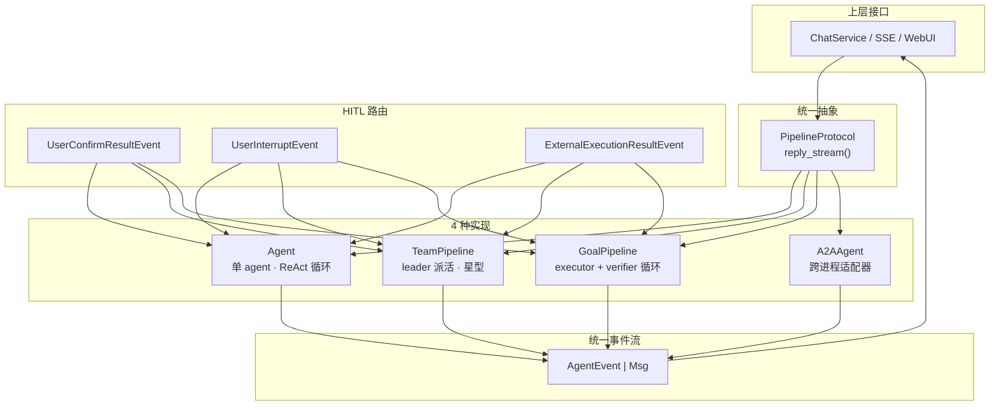

# AgentScope 2.0 的多 Agent：4 种编排形态与源码实现

> 这篇拆 AgentScope 2.0 当前的 multi-agent 实现，全部结论来自 upstream/main 的源码，不是文档转述。
>
> 涉及的四个文件：
>
> - `src/agentscope/pipeline/_base.py`（884 B）
> - `src/agentscope/pipeline/_team_pipeline.py`（16 KB）
> - `src/agentscope/pipeline/_goal_pipeline.py`（14 KB）
> - `src/agentscope/agent/_a2a_agent.py`（24 KB）

***

## 📌 什么时候你真的需要多 Agent

先说结论，因为大部分"多 Agent"需求用单 Agent + 工具就能解决。

**用多 Agent 的三个信号：**

1. **子任务需要独立上下文** —— 一个 agent 的上下文塞不下，或者塞进去之后污染主任务的推理
2. **子任务可以并行** —— 三个方向同时查，比串行快一个数量级
3. **角色需要不同 prompt / 不同工具集** —— 写代码的和做 review 的不该用同一套 system prompt

**不该用的三个信号：**

1. "想让它更聪明" —— 多 agent 不会让单次推理变强
2. "拆成几个 agent 显得工程化" —— 拆分本身有成本，收益不确定
3. "每个 agent 都要看到全部上下文" —— 那共享上下文更省事

判断方法：**先问"这些子任务之间需要互相看到对方的中间过程吗？"** 需要 → 单 agent 多轮；不需要 → 多 agent。

AgentScope 2.0 的四种编排形态，对应的是"不需要互相看到中间过程"这一侧。

***

## 💻 先看代码：4 种形态怎么用

### 形态 1：TeamPipeline —— leader 派活

```python
from agentscope.agent import Agent
from agentscope.pipeline import TeamPipeline, TeamMember

leader = Agent(name="lead", system_prompt="...", model=model, toolkit=toolkit)

pipeline = TeamPipeline(
    leader=leader,
    members=[
        TeamMember(agent=researcher, description="查资料，返回结论和来源"),
        TeamMember(agent=coder, description="写代码，返回文件和运行方式"),
    ],
)

async for event in pipeline.reply_stream(UserMsg(name="user", content="...")):
    ...
```

**`TeamMember.description` 是 leader 唯一的选人依据** —— 它会被拼进 leader 看到的工具描述里：

```python
self.description = (
    "Assign a task to a team member and get its reply back as the result. "
    "The members are:\n"
    + "\n".join(f"- {_.agent.name}: {_.description}" for _ in members)
)
```

leader 拿到的工具 schema：

```json
{
  "member": {"enum": ["researcher", "coder"]},
  "prompt": {"type": "string"}
}
```

`prompt` 的描述里有一句关键约束：

> "The complete task for the member. **It cannot see your context, so include everything it needs.**"

这是整个设计的核心 —— member 看不到 leader 的上下文，所以 leader 得把任务写全。

### 形态 2：GoalPipeline —— executor 干活，verifier 验收

```python
from agentscope.pipeline import GoalPipeline

pipe = GoalPipeline(
    executor=executor,
    verifier=verifier,
    max_iters=10,        # 最多迭代 10 轮
    max_retries=3,       # 结构化输出失败重试 3 次
)

await launch_console(agent=pipe)
```

两个 agent 通过 **structured output** 交换信息，不是自由对话：

```python
class _ExecutionReport(BaseModel):
    report: str    # 文件路径、入口点、怎么跑、运行环境

class _VerificationResult(BaseModel):
    result: Literal["pass", "fail", "impossible"]
    message: str
```

### 形态 3：A2AAgent —— 跨进程 / 跨框架

```python
from agentscope.agent import A2AAgent

remote = A2AAgent(agent_card=card)   # card 来自远端服务
async for event in remote.reply_stream(UserMsg(name="user", content="...")):
    ...
```

### 形态 4：SOP —— 多步流程

`sop/_engine.py`，把多步任务当标准操作流程跑，标记为 `Experimental`。

***

## 🔬 深入：源码级拆解

### 抽象层：PipelineProtocol 用 `def` 不用 `async def`

```python
# src/agentscope/pipeline/_base.py
class PipelineProtocol(Protocol):
    """What a pipeline has to offer to go where an agent goes.

    Declared as a plain ``def`` returning an async generator rather than
    an ``async def``: such a function is called, not awaited, and an
    ``async def`` here would be satisfied by neither ``Agent`` nor any
    pipeline.
    """

    def reply_stream(
        self,
        inputs: Msg | list[Msg] | UserConfirmResultEvent
        | UserInterruptEvent | ExternalExecutionResultEvent,
    ) -> AsyncGenerator[AgentEvent | Msg, None]:
        """Reply to the given inputs and stream what happens."""
```

**协议只有 4 行。** `Agent` 和 `Pipeline` 都满足它，所以任何接受 pipeline 的地方都能塞 agent，反之亦然。

多 Agent 在 AgentScope 里的根本抽象不是"一类特殊的 Agent"，是**换一个 `reply_stream` 实现**。

### TeamPipeline：leader 拿一个外部工具

```python
class _TeamAssign(ToolBase):
    name: str = "TeamAssign"
    is_external_tool: bool = True       # ← 标记：pipeline 自己执行，不真正跑
    is_concurrency_safe: bool = True
    is_read_only: bool = False
```

注册给 leader：

```python
if not self._tool_registered:
    await self.leader.toolkit.add_tool(self._assign_tool)
    self._tool_registered = True
```

leader 调 `TeamAssign` 时，`Agent` 层会发出 `RequireExternalExecutionEvent`（因为 `is_external_tool=True`），pipeline 把它截下来自己执行：

```python
async for evt in self.leader.reply_stream(inputs):
    if isinstance(evt, RequireExternalExecutionEvent) and all(
        _.name == _TeamAssign.name for _ in evt.tool_calls
    ):
        assignments.extend(evt.tool_calls)
        continue          # ← 截住，不 yield 给调用方
    yield evt
```

**leader 的中间步骤全部被吞掉。** member 跑完后，它的 final reply 变成 leader 视角下的 tool result：

```python
round_results.append(
    ToolResultBlock(
        id=tool_call.id,
        name=_TeamAssign.name,
        output=[_ for _ in evt.content
                if isinstance(_, (TextBlock, DataBlock))]
               or "The member finished without a reply.",
        state=_RESULT_STATES[evt.finished_reason],
    ),
)
```

结果状态由 member 的 `finished_reason` 映射：

```python
_RESULT_STATES = {
    ReplyFinishedReason.COMPLETED:        ToolResultState.SUCCESS,
    ReplyFinishedReason.EXCEED_MAX_ITERS: ToolResultState.SUCCESS,
    ReplyFinishedReason.INTERRUPTED:      ToolResultState.INTERRUPTED,
    ReplyFinishedReason.ERROR:            ToolResultState.ERROR,
}
```

### 并发模型：跨 member 并发，同 member 串行

```python
groups: dict[str, list[ToolCallBlock]] = {}
for tool_call in tool_calls:
    member = self._parse(tool_call)["member"]
    groups.setdefault(member, []).append(tool_call)
```

每个 group 一个 task：

```python
async def run_group(name: str, calls: list[ToolCallBlock]) -> None:
    member = self.members[name]
    for tool_call in calls:           # ← 同 member 顺序执行
        async for evt in member.agent.reply_stream(...):
            ...
        if self._is_parked(member):
            break                     # ← park 了，剩余的排队等恢复
```

不同 group 用 `asyncio.gather` 并发：

```python
async def run_all() -> None:
    tasks = [
        asyncio.create_task(run_group(*group))
        for group in groups.items()
    ]
    try:
        await asyncio.gather(*tasks)
    finally:
        # gather propagates a member failure without stopping siblings.
        for task in tasks:
            if not task.done():
                task.cancel()
        await asyncio.gather(*tasks, return_exceptions=True)
        await queue.put(sentinel)
```

**一个 member 挂了不影响兄弟。** 这行注释是重点：

> "gather propagates a member failure without stopping siblings."

事件通过 `asyncio.Queue` 汇聚，保证多 member 的事件流不交错成一团：

```python
queue: Queue = Queue()
...
while (evt := await queue.get()) is not sentinel:
    yield evt
```

结果回填 leader 上下文时按 **leader 的调用顺序**排，不按完成顺序：

```python
order = {_.id: i for i, _ in enumerate(tool_calls)}
results.extend(sorted(round_results, key=lambda _: order[_.id]))
```

### members 之间不能直接通信

源码 docstring 逐字：

> "Members do not talk to each other; a member's result always returns to the leader."

**星型拓扑。** 所有跨成员信息必须经 leader 中转。

这是真实的 trade-off：

| | 好处 | 代价 |
|---|---|---|
| leader 中转 | 每个 member 上下文干净、可独立演进 | leader 成了瓶颈；N 个 member 的结果全压在一个上下文里 |
| member 互聊 | 少一次中转 | 上下文互相污染，串扰难治；协议复杂度上一个台阶 |

AgentScope 选了前者，代价是 leader 的 prompt 里必须把任务写全（`prompt` 字段那句 "It cannot see your context"）。

### 上下文隔离：reset_members

```python
if isinstance(evt, ReplyEndEvent) and self.reset_members:
    for member in self.members.values():
        member.agent.state.context.clear()
        member.agent.state.summary = ""
```

**leader 一轮回复结束，所有 member 上下文清空。**

`reset_members=True`（默认）的语义，源码说得很清楚：

> "Within one reply the leader can follow up with a member; across replies each member starts afresh."

同一轮内 leader 可以追问 member；跨轮次 member 重新开始。

### HITL：按参与者隔离，靠 reply_id 路由

member 需要用户确认时，跟普通 agent 一样 park：

```python
def _is_parked(member: TeamMember) -> bool:
    return member.agent.state.has_awaiting_tool_calls(member.agent.name)
```

确认结果回来时，按 `reply_id` 找到 parked 的那个 member：

```python
def _parked_member(self, reply_id: str) -> TeamMember:
    """The member parked on the reply the given result belongs to."""
```

**leader 同时 park 在 assignment 上**，等 member 回来：

```python
if len(results) < len(assignments):
    if results:
        async for evt in self.leader.reply_stream(inputs):
            yield evt
    return              # ← 流在这里结束，等 HITL 恢复
```

三种事件的分工：

| 事件 | 作用 |
|---|---|
| `UserInterruptEvent` | 中断所有 parked 参与者 |
| `UserConfirmResultEvent` | 路由给 park 在它上面的 member |
| `ExternalExecutionResultEvent` | 路由给 park 在它上面的 member |

### GoalPipeline：靠 structured output 强制产出

executor 必须生成符合 `_ExecutionReport` 的结构化输出：

```python
async for _ in self.executor.reply_stream(
    inputs=executor_inputs,
    structured_schema=_ExecutionReport,
    yield_final_msg=True,
):
    yield _
    if isinstance(_, Msg) and _.finished_reason == ReplyFinishedReason.COMPLETED \
            and _.structured_output:
        execution_report = _.structured_output.get("report")
```

生成失败就重试并追加提醒：

```python
if execution_report is None:
    self._executor_retries += 1
    self._check_retry_budget(self._executor_retries, "executor")
    executor_inputs = UserMsg(
        name="system",
        content=(
            "<system-reminder>You have failed to generate valid execution "
            "report. You should call the 'GenerateStructuredOutput' tool "
            "with a valid structured output that matches the schema.</system-reminder>"
        ),
    )
```

verifier 拿到目标 + 报告，判定 pass / fail / impossible：

```python
instruction = UserMsg(
    name="user",
    content=[
        TextBlock(text="<system-reminder>Now you should verify the work done "
                       "by the executor. The goal is as follows, you should "
                       "verify whether the executor has achieved the goal.<goal>"),
        *(self._goal or []),
        TextBlock(text=f"</goal>\nThe executor's achievement report is as "
                       f"follows:\n<report>{execution_report}</report>"
                       "</system-reminder>"),
    ],
)
```

三个出口：

```python
elif final_msg.structured_output.get("result") in ("pass", "impossible"):
    if final_msg.structured_output["result"] == "impossible":
        logger.info("The verifier judged the goal impossible: %s", ...)
    break_loop = True           # ← 结束
else:
    self._iters += 1
    if self.verifier_reset_context:
        self.verifier.state.context.clear()
        self.verifier.state.summary = ""
    if self._iters >= self.max_iters:
        break_loop = True
        break
    # 反馈给 executor 继续
    feedback = final_msg.structured_output.get("message")
```

**verifier 判 `fail` 时，feedback 回到 executor，循环继续。** 判 `impossible` 也结束 —— 避免"永远做不到还一直试"。

迭代预算存在实例上：

```python
# Rounds already judged. On the instance rather than in
# ``reply_stream``, so a HITL resume does not restart the budget.
self._iters = 0
```

**HITL 恢复不重置预算。** 这个细节容易漏 —— 恢复后如果预算重置，agent 可以无限循环。

### A2AAgent：不继承 Agent

```python
class A2AAgent:
    """A stateful client-side adapter for an A2A 1.0 agent.

    This class intentionally provides Agent-like interaction methods
    without inheriting :class:`agentscope.agent.Agent`. A local ``Agent``
    owns a model, toolkit, state, and reasoning loop; this adapter
    delegates those concerns to the remote A2A server and owns only the
    remote conversation (``context_id``) and the Task the next message
    continues (``task_id``), both held in
    :class:`agentscope.state.A2AAgentState`.
    """
```

本地 Agent 有 model / toolkit / state / reasoning loop；A2A adapter 这些全在远端，它只持有两样：

- `context_id` —— 远端会话
- `task_id` —— 下条消息续哪个 Task

**Part 到 content block 的映射**：

| A2A Part | AgentScope |
|---|---|
| text | `TextBlock` |
| raw bytes / URL | `DataBlock` |

协议版本自动协商：SDK 按 AgentCard 声明的版本选最新的，没有就退化到 0.3 兼容层。

***

## 🏛️ 三条贯穿所有形态的设计原则

### 1. 统一事件流

所有编排方式产出的都是同一种东西：

```python
AsyncGenerator[AgentEvent | Msg, None]
```

leader 的事件、member 的事件、GoalPipeline 两个 agent 的事件，**混在同一条流里**。

上层（ChatService / SSE / WebUI）不需要知道底下跑的是单 agent 还是 pipeline。

### 2. Pipeline 与 Agent 可互换

`PipelineProtocol` 只有一个方法，`Agent` 和所有 Pipeline 都满足它。`launch_console(agent=pipe)` 这种写法就是证据 —— 参数名叫 `agent`，传进去的是 pipeline。

### 3. HITL 全链路打通

`UserConfirmResultEvent` / `ExternalExecutionResultEvent` / `UserInterruptEvent` 在 **Agent、TeamPipeline、GoalPipeline** 三层都能收，靠 `reply_id` 路由到具体参与者。

三层各自的路由策略：

| Pipeline | parked 的处理 | 结果回来时 |
|---|---|---|
| Agent | 自己 park | 自己恢复 |
| TeamPipeline | member park，leader 也 park | 找到 member → 跑完 → 结果回 leader |
| GoalPipeline | executor 或 verifier park | 按 `reply_id` 判断是哪个 |

***

## 📐 全景图



***

## 💡 选型对照

| 需求 | 用什么 | 理由 |
|---|---|---|
| leader 派活给几个专家，并行 | `TeamPipeline` | 跨 member 并发，leader 只看摘要 |
| 一个 agent 干，反复验收 | `GoalPipeline` | verifier 自动判定 + 反馈迭代 |
| 固定多步流程 | `SOP` | 步骤是人定义的，不是 agent 自己决定 |
| 调外部团队已有的 agent 服务 | `A2AAgent` | A2A 标准协议，不自己造 |
| 只是一件事拆几步 | 单 `Agent` 多轮 | 别为拆而拆 |

***

## 🔗 相关

- [AgentScope 2.0 W1：架构全景 + 核心类图](/posts/ai-practice/ai-app/agentscope-w1-architecture) —— 单 agent 视角的架构
- [AgentScope 2.0 W4：消息与通信](/posts/ai-practice/ai-app/agentscope-w4-message-communication) —— MessageBus 六种原语
- [我给 AgentScope 报了 5 个"bug"，只有 1 个值得修](/posts/ai-practice/ai-app/upstream-bug-report-miss-rate-100-percent) —— 上游协作的 5 道验证

源码：
- [pipeline/_base.py](https://github.com/agentscope-ai/agentscope/blob/main/src/agentscope/pipeline/_base.py)
- [pipeline/_team_pipeline.py](https://github.com/agentscope-ai/agentscope/blob/main/src/agentscope/pipeline/_team_pipeline.py)
- [pipeline/_goal_pipeline.py](https://github.com/agentscope-ai/agentscope/blob/main/src/agentscope/pipeline/_goal_pipeline.py)
- [agent/_a2a_agent.py](https://github.com/agentscope-ai/agentscope/blob/main/src/agentscope/agent/_a2a_agent.py)
- [examples/pipeline/goal/goal_pipeline.py](https://github.com/agentscope-ai/agentscope/blob/main/examples/pipeline/goal/goal_pipeline.py)
