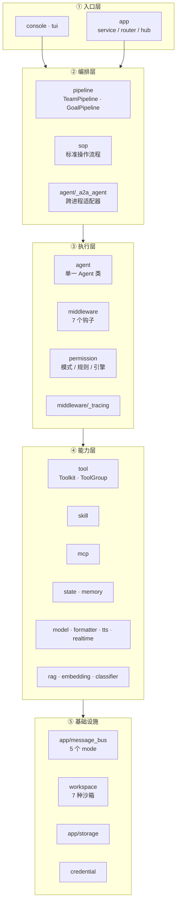
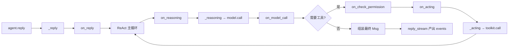
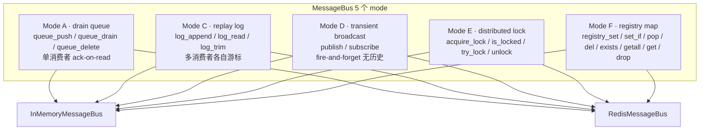
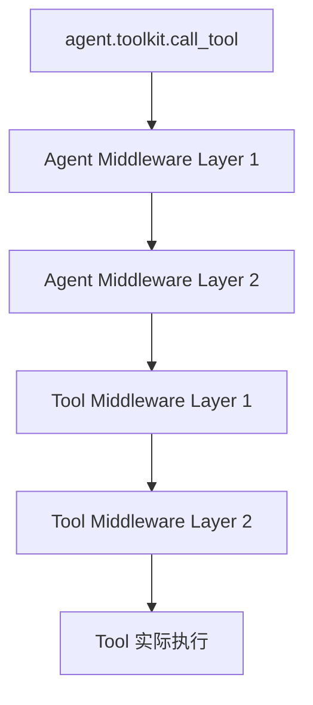

# AgentScope 2.0 架构全景（2026-10 复核）：从单一 Agent 到统一事件流

> **系列**：[8 周成为 Agent 应用架构师](https://github.com/sunrong1/agentscope/blob/learning-journal/LEARNING.md) · Week 1（2026-10-30 复核刷新版）
> **学习对象**：[AgentScope 2.0](https://github.com/agentscope-ai/agentscope)（阿里达摩院出品的多智能体框架）
> **完整承诺**：[LEARNING.md](https://github.com/sunrong1/agentscope/blob/learning-journal/LEARNING.md)
> **学习记录**：[sunrong1/agentscope · learning-journal 分支](https://github.com/sunrong1/agentscope/tree/learning-journal)

<!-- more -->

## 📌 这篇为什么重写

初版写于 2026-07-18。三个月后（`main` 从 `30ca3ef3` 到 `86d8cd08`）上游合了 44 个 commit，架构层面动了三处：

| 变化 | 初版 | 现在 |
|---|---|---|
| 顶层模块数 | 20 | **26**（+classifier / console / pipeline / realtime / sop / tui）|
| `agent/_agent.py` | 2910 行 | **3927 行** |
| Middleware 钩子 | 5 个 | **7 个**（+`on_check_permission` / `on_compress_context`）|
| Workspace 沙箱后端 | 5 种 | **7 种**（+bubblewrap / applecontainer）|

**重写时还发现初版有两处事实错误**（下面标了「修正」）。

所有结论重新对着 `main` 的源码核过。

***

## 🗺️ 模块地图

26 个顶层模块，按"一个 Agent 跑起来要碰什么"分层：



**读这张图的顺序**：入口层决定"谁在驱动"，编排层决定"谁在决策"，执行层是 ReAct 循环，能力层是可替换的零件，基础设施层是可替换的存储与传输。

***

## 发现 1：单一 Agent 类 + Middleware 钩子链（仍然成立，但钩子变了）

跟 LangChain、AutoGen 的"按子类拆分 Agent"路线不同，**AgentScope 2.0 走的是反方向**：

**一个 `Agent` 类，所有行为差异通过 Middleware 钩子组合实现。**



### ⚠️ 修正：初版写的"6 个钩子"不对

初版的表格列了 6 个（含 `on_compress_context`），但对着 2026-07-17 的 `middleware/_base.py` 核，官方当时写的是：

> "Middleware provides interception mechanisms at **5 key execution points** in the Agent lifecycle"

**`on_compress_context` 当时还不存在。** 我把还没落地的钩子写进了表格。

### 现在是 7 个（官方原文）

| 钩子 | 类型 | 触发时机 | 典型用途 |
|---|---|---|---|
| `on_reply` | 洋葱 | 整个 reply 入口/出口 | 限流、计时 |
| `on_reasoning` | 洋葱 | 模型推理前后 | 输出改写、guardrails |
| **`on_check_permission`** | 洋葱 | **工具权限判定** | 审计、自定义授权策略 |
| `on_acting` | 洋葱 | 工具调用前后 | 工具白名单、脱敏 |
| `on_model_call` | 洋葱 | 实际调用 model | 成本统计、fallback |
| **`on_compress_context`** | 洋葱 | **上下文压缩** | 自定义压缩策略 |
| `on_system_prompt` | 变换 | 拼装 system prompt | 动态注入上下文 |

新增的两个都在洋葱型，`next_handler` 签名不变。

**为什么 `on_check_permission` 值得单独说**：权限判定原本在 `Agent` 内部直接调 `PermissionEngine`，middleware 插不进去。开放这个钩子之后，**"要不要放行这次工具调用"变成了可编排的一环** —— 审计中间件、策略中间件、临时提权中间件都能挂上去，而不用改 Agent 主类。

***

## 发现 2：MessageBus 的原语抽象（修正：不是"6 种"）

初版写"6 种原语"，表格里只列了 5 行。实际是 **5 个 mode**，其中 A / C / D 三种是官方定义的"消费语义"原语，E / F 是配套工具：



| mode | 业务 | 消费语义 |
|---|---|---|
| A 队列 | Session inbox、跨进程任务 | 单消费者，ack-on-read，读完即从存储移除 |
| C 日志 | Session 事件流（可重放）| 多消费者各自维护游标，条目留到被 trim |
| D 广播 | 唤醒信号、取消 | 只投递给当前订阅者，无历史 |
| E 锁 | Session 互斥 | 集群级互斥 |
| F 注册表 | 后台任务 / session / inbox 注册 | 哈希命名空间 |

### 官方明确说了「为什么没有 counted broadcast」

这一段原文解释得很清楚：

> "Counted broadcast (one entry consumed by N distinct readers) is **intentionally not exposed** as a primitive: in practice it requires consumer-group coordination (Redis Streams' XREADGROUP/XACK semantics) and adds substantial state. Producers wanting 'fan out to N members' should **fan out at write time** — push one entry per recipient inbox using Mode A. The bus stays simple; deduplication is the producer's responsibility."

**翻译**：要"一条消息投给 N 个人"，别指望 bus 提供原语，**在 producer 侧用 Mode A 给 N 个收件箱各推一份**。

**去重责任落在业务代码，不落在 bus。** 这是个明确的取舍 —— bus 保持极简（5 个 mode / 20 个抽象方法），业务承担 fan-out 逻辑。

### 配套的两层正交

- **Storage（持久化）** 和 **MessageBus（实时传输）** 是正交的两层，可独立选型
- 单测用 `InMemoryMessageBus`，生产用 `RedisMessageBus`，**业务代码完全透明**

***

## 发现 3：Tool 也有自己的 Middleware（双层洋葱）

`ToolBase` 有自己的一套 `ToolMiddlewareBase`：



- 外层（Agent Middleware）：拦截整个 reply / reasoning / acting
- 内层（Tool Middleware）：拦截单个 tool 的输入输出

`ToolMiddlewareBase.on_tool_call` 的签名：

```python
async def on_tool_call(
    self,
    tool: "ToolBase",
    input_kwargs: dict[str, Any],
    next_handler: Callable[..., AsyncGenerator[ToolChunk, None]],
) -> AsyncGenerator[ToolChunk, None]:
    ...
```

`next_handler` **永远**返回 async generator，所以 middleware **不需要知道**底层是流式还是非流式。

***

## 发现 4：统一事件流（2.0 真正的主轴）

`event/_event.py` 里 31 个 `EventType`，全部继承自同一个 `EventBase`：

```python
class EventType(StrEnum):
    REPLY_START = "REPLY_START"
    REPLY_END = "REPLY_END"
    MODEL_CALL_START = "MODEL_CALL_START"
    MODEL_CALL_END = "MODEL_CALL_END"
    TEXT_BLOCK_START = "TEXT_BLOCK_START"
    TEXT_BLOCK_DELTA = "TEXT_BLOCK_DELTA"
    TEXT_BLOCK_END = "TEXT_BLOCK_END"
    ...
    REQUIRE_USER_CONFIRM = "REQUIRE_USER_CONFIRM"
    REQUIRE_EXTERNAL_EXECUTION = "REQUIRE_EXTERNAL_EXECUTION"
    USER_INTERRUPT = "USER_INTERRUPT"
    ...
```

**关键在于所有编排方式产出同一种东西**：

```python
AsyncGenerator[AgentEvent | Msg, None]
```

单 Agent 的事件、TeamPipeline 里 leader 和 member 的事件、GoalPipeline 里 executor 和 verifier 的事件，**混在同一条流里**。

上层（ChatService / SSE / WebUI）**不需要知道底下跑的是单 Agent 还是 pipeline**。

***

## 发现 5：编排从 Agent 里独立成一层（3 个月里最大的架构变化）

初版写架构时，`pipeline` 这个目录在 2.0 里**被删过**（`36a673c4`，2026-04-08，连带 `_msghub.py` 一起下掉）。现在它回来了，但内容完全不同：

| 形态 | 定位 |
|---|---|
| `TeamPipeline` | leader 拿一个 external tool 派活给 member，跨 member 并发、同 member 串行 |
| `GoalPipeline` | executor + verifier 循环，靠 structured output 强制产出 |
| `A2AAgent` | 跨进程 / 跨框架适配器，**不继承 `Agent`**（model / toolkit / loop 都在远端）|
| `SOP` | 多步流程编排（Experimental）|

抽象层只有 4 行：

```python
class PipelineProtocol(Protocol):
    def reply_stream(
        self,
        inputs: Msg | list[Msg] | UserConfirmResultEvent
        | UserInterruptEvent | ExternalExecutionResultEvent,
    ) -> AsyncGenerator[AgentEvent | Msg, None]:
        """Reply to the given inputs and stream what happens."""
```

**用 `def` 而不是 `async def`** —— 因为 pipeline 是被调用的，不是被 await 的。这样 `Agent` 和 `Pipeline` 满足同一个协议，**任何接受 pipeline 的地方都能塞 agent，反之亦然**。

**多 Agent 在 2.0 里的根本抽象不是"一类特殊的 Agent"，是换一个 `reply_stream` 实现。**

> 完整拆解见 [AgentScope 2.0 的多 Agent：4 种编排形态与源码实现](/posts/ai-practice/ai-app/agentscope-2-multi-agent-orchestration.html)

***

## 🏛️ 架构评判（2026-10 复核）

**三个月后我的结论变了。** 初版说"单一 Agent 类 + Middleware = 极高扩展性"，那时候觉得架构已经收敛了。现在看，收敛的方向是**更统一的接口** —— 不是更少的东西：

| | 三个月前 | 现在 |
|---|---|---|
| 多 Agent 怎么表达 | 没有一等公民（MsgHub 被删）| **`PipelineProtocol` 一等公民**，Agent 与 Pipeline 可互换 |
| 行为差异怎么表达 | Middleware 链 | Middleware 链（**多了权限判定这个关键钩子**）|
| 上下文怎么切 | Agent 内部状态 | Pipeline 生命周期（`reset_members` 一轮清空）|
| 事件怎么流 | `reply_stream` | `reply_stream`（**31 个 EventType 统一所有编排**）|

**仍然成立的优点**：

- 单一 Agent 类 + Middleware —— 加新能力不用碰主类
- MessageBus 5 个 mode —— 极简，去重责任明确落在业务侧
- Storage / MessageBus 正交
- FastAPI 装配式注入

**三个月后暴露的局限**：

- `_agent.py` 3927 行，**单文件已经偏大** —— 中间件多之后调用链不直观，Tracing 是刚需不是可选项
- Middleware 7 个钩子之后，**"哪些钩子被实现了"成了运行时才知道的事** —— `is_implemented()` 靠反射检查，出错时是运行时而非启动时暴露
- Workspace 沙箱 7 种后端（docker / k8s / e2b / daytona / opensandbox / bubblewrap / applecontainer），**运维复杂度随数量线性增长**
- `permission` 引擎的规则层（`DEFAULT` / `ACCEPT_EDITS` / `EXPLORE` / `DONT_ASK` / `BYPASS`）语义细微，**开 `on_check_permission` 之前你没法在 middleware 里插手**

***

## 📌 一句话总结

> **AgentScope 2.0 的架构主轴不是"Agent 有多强"，是"接口有多统一"。**
>
> 7 个 Middleware 钩子、31 个 EventType、4 行 `PipelineProtocol` —— **都指向同一件事：让编排方式成为可替换的实现细节，而不是架构决策。**

***

## 🔗 资源

- 📂 学习仓库：[sunrong1/agentscope · learning-journal](https://github.com/sunrong1/agentscope/tree/learning-journal)
- 📋 公开承诺：[LEARNING.md](https://github.com/sunrong1/agentscope/blob/learning-journal/LEARNING.md)
- 🏛️ 官方仓库：[agentscope-ai/agentscope](https://github.com/agentscope-ai/agentscope)
- 📖 官方文档：[docs.agentscope.io](https://docs.agentscope.io/)

**本次复核对着核的源码位置**：

| 结论 | 文件 |
|---|---|
| 7 个 Middleware 钩子 | `src/agentscope/middleware/_base.py` |
| MessageBus 5 个 mode | `src/agentscope/app/message_bus/_base.py` |
| 31 个 EventType | `src/agentscope/event/_event.py` |
| PipelineProtocol | `src/agentscope/pipeline/_base.py` |
| TeamPipeline / GoalPipeline | `src/agentscope/pipeline/_team_pipeline.py` / `_goal_pipeline.py` |
| 7 种沙箱后端 | `src/agentscope/workspace/` |

***

## 📚 AgentScope 8 周学习系列

- 🗺️ **本篇：架构全景（2026-10 复核版）**（你正在读）
- 🤖 **[多 Agent：4 种编排形态与源码实现](/posts/ai-practice/ai-app/agentscope-2-multi-agent-orchestration.html)** — TeamPipeline / GoalPipeline / A2A 拆到源码行
- 🐛 **[我给 AgentScope 报了 5 个"bug"，只有 1 个值得修](/posts/ai-practice/ai-app/upstream-bug-report-miss-rate-100-percent.html)** — 上游协作的 5 道验证
- 🔧 **[配套工具：SM-2 复习系统](/posts/ai-practice/ai-app/sm2-review-system.html)** — 420 行 Python 的自适应复习
- 📝 **[W2：真学习复盘](/posts/ai-practice/ai-app/agentscope-w2-real-learning.html)** — 从伪产出到真读代码 5 天记录

**完整承诺**：[LEARNING.md](https://github.com/sunrong1/agentscope/blob/learning-journal/LEARNING.md)
