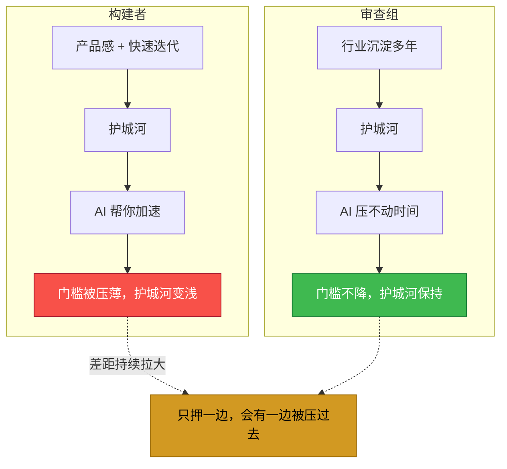
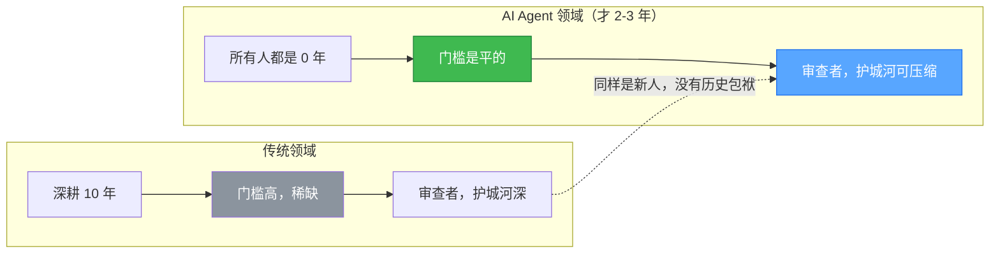
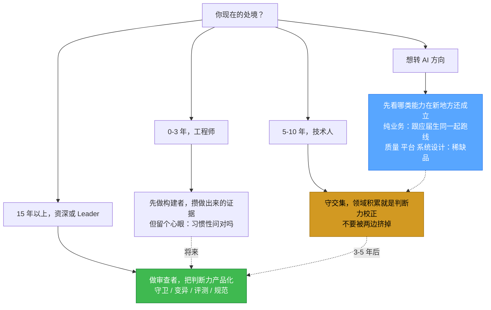

---
title: AI 时代的两种人：构建者与审查者
icon: users
date: 2026-10-22
update: 2026-10-28
categories:
  - 职业发展
tags:
  - AI 时代
  - 职业发展
  - 认知提升
  - 方法论
author: Mr.Sun
star: true
public-safe: true
---***
# AI 时代的两种人：构建者与审查者

> 去年开始，我同时在做两件看起来矛盾的事。
>
> 一件是从 0 到 1 建平台——想法、架构、落地。
> 另一件是判断质量——这个 Agent 做的事到底对不对、这个设计有没有问题。
>
> 一直以为这是一堆杂活。直到最近听到一个框架，才发现**这不是矛盾，这是两种人**。

***

## 一、这个框架

先说框架本身。这是腾讯 CoddyBuddy 舒魁高级架构师在分享里提的一个划分，我把它记下来了，因为它解释了我这两年的一些困惑。

AI 时代的人才，大致分两类：

| | **构建者（超级个体）** | **审查组（领域专家）** |
|---|---|---|
| **是谁** | 资深研发人员，或者产品 | 在行业沉淀多年的领域专家 |
| **底色** | 有产品思维，能用 Agent 写代码创造，是有设计直觉和结构化表达能力的通才 | 有极强的系统思维 |
| **工作重心** | 通过 Agent 把想法从 0 到 1 快速落地 | 审查复杂功能的框架、产品逻辑、用户体验，把控质量 |
| **核心能力** | 综合能力、快速迭代、产品感 | 深度专业能力、系统思维、判断力 |

这个划分我觉得挺准的，因为它解释了一个我观察了很久的现象：

> **同样用 AI，产出差一个量级。**

不是谁更会用工具，是**两类人在解完全不同的问题**。

***

## 二、但两类人的护城河，性质不一样

这是我觉得这个框架最值得往下推的地方，也是我原来没想到的。

| | 护城河 | AI 拿它怎么办 |
|---|---|---|
| **构建者** | 产品感 + 快速迭代 | **AI 帮你加速，门槛在降** |
| **审查组** | 行业沉淀多年 | **AI 压不动你的年限，护城河反而更安全** |

构建者的护城河，本质是「用更少的时间把想法变成能跑的东西」。这件事 AI 一旦接上，差距会被迅速抹平——**这不是个人能力问题，是工具代际问题。**

审查组的护城河不一样。它是**时间堆出来的**——你知道这个行业的坑在哪、知道哪句话听起来对但是错的、知道客户真正在意什么。这些东西 AI 学不会，因为它不在数据里。

**所以 AI 时代，审查者的位置其实比构建者安全。**

***

## 三、有积累的人该押哪边？

这是我写这篇文章真正想回答的问题。

先把两个选项摊开。

**押构建者**：跟更年轻的人同赛道，拼「谁更有产品感、谁迭代更快」。这个赛跑我赢不了——**他们没有包袱，试错成本低，我能拿 AI 快速出东西的地方，他们一样能出。** 而且 AI 还在继续拉平这个差距。

**押审查者**：护城河安全，但需要「多年积累」。我在传统领域积累了十余年，够；**但在 AI Agent 这个领域，我是个新人。**

那是不是只能选一个？

**不是。而且答案藏在 AI Agent 这个领域本身。**

***

### 一个我一开始没注意到的点

「行业沉淀多年」这个门槛，在传统领域和在 AI Agent 领域，**完全不是一个难度**。

传统领域里，某个具体方向深耕十年的人，行业里可能有几十个，门槛实打实高。

**但在 AI Agent 这个领域——所有人都是零年。**

这个领域真正被大规模关注，也就两三年。所以「多年沉淀」在这里，是相对而言的。**门槛是平的。**

> **换句话说：审查者要攒的那几年，在新领域里是可以被压缩的。**

这不是侥幸，这是新领域给「转型者」的红利。

***

### 我的选择

**我押构建者，但用审查者做底座。**

理由拆开说：

**为什么先做构建者**

我这些年的技术积累，最终会体现在**判断力**上，而判断力在构建者路径上体现为「知道该做什么、知道什么是好的」——这正是产品感的来源。**我没法假装自己还年轻，但我也不需要。** 构建者路径上，这些年的经验让我少走弯路、少做无用功，这本身就是优势。

**为什么同时攒审查者资产**

因为构建者的护城河会被 AI 压薄，而审查者的不会。**构建者是我现在能兑现的，审查者是我需要时间攒的。** 两件事不冲突，因为它们本来就是同一个人身上的两种能力。

**具体怎么做**

- 手上在做的，必须有 **0 到 1 的完整交付**——从想法到有人用。这是在攒构建者证据。
- 每个交付，必须留下**「为什么这么做」的判断痕迹**——架构取舍、放弃了什么方案、为什么。这是在攒审查者资产。
- 领域上，**主动选一个垂类扎下去**，不要泛。**审查者的护城河是深度，不是广度。**

***

## 四、给不同的人一张地图

这个框架对不同处境的人，指向是不同的。

**如果你是 0-3 年的工程师**

先做构建者。**你需要的是「我能做出来」的证据**，而不是「我知道什么是对的」——后者在没有做过之前是空谈。

AI 时代对一个新人的意义在于：**你从 0 到 1 的成本被压到了以前的三分之一。**用这个杠杆多做几个完整的东西，比读十本书有用。

但请留一个心眼：**习惯性地问「这个方案对吗、还有没有别的路」**。这是你将来往审查者走的唯一入口。

**如果你是 5-10 年的技术人（有积累但不确定方向）**

你最稀缺的地方在交集：

> **既懂领域、能判断质量，又懂用 Agent 加速。**

纯构建者——年轻人也能做，而且更快。
纯审查者——不会用 Agent，产出速度跟不上团队的节奏。

**你的领域积累，恰好是 Agent 加速的「判断力校正」**。别人用 Agent 跑得快但方向错，你跑得一样快但知道对。

**这是你最该守的位置，也是最容易被两边挤掉的位置——因为你既不够年轻，也还没到够老。**

**如果你是 15 年以上的资深专家 / 技术 Leader**

审查者。而且要**把判断力产品化**——不是自己审，是让机制审。

具体形态是：守卫、变异测试、评测 Harness、评审规范。**你的判断力要变成流水线的一部分，而不是你坐在那里逐个看。**

因为 AI 会把你的产出量拉高到你审不完，最后要么放手（质量失控），要么自己变成瓶颈（团队停在你身上）。

**如果你正在考虑转 AI 方向**

先说一个反直觉的结论：

> **不要因为「AI 才是未来」而转。你要转的原因是「你原来的积累在这个新领域还能用」。**

如果你原来做的是纯业务开发，转 AI Agent 之后你可能和应届生站在同一起跑线——**原来这些年的积累在这个新领域清零了。**
但如果你原来做的是**质量、平台、系统设计**这类工作，那你的积累**在 AI Agent 领域是稀缺品**，因为这个领域最缺的就是「怎么判断做对了没有」的人。

**选领域的时候，先看你哪一类能力在新地方还成立。**

***

## 五、这篇其实想说的话

AI 时代的选择题，不是「学不学 AI」，是**「你要在哪一层建立不可替代性」**。

构建者的不可替代性，会被 AI 一寸一寸削薄。
审查者的不可替代性，AI 暂时碰不到。

**但两者的交集，是当下最舒服的位置**——你能用 Agent 把想法落地，也能判断它落得对不对。

我这些年的技术积累，换算成这个框架，是**刚好够从审查者往构建者走，但还不够在 AI 领域做审查者**。

**所以我押构建者，用审查者的能力做底座，等着把审查者那块补上。**

***

## 六、几个能落地的自检问题

如果不确定自己在哪一类，或者想从一类往另一类走，这几个问题可以直接问自己：

**我是不是构建者？**
- 最近半年，我有没有独立把一个想法变成「有人在用」的东西？
- 我做决策时，是靠「用户会要」还是靠「架构上更优雅」？

**我是不是审查者？**
- 换个行业/领域，我还能一眼看出这个方案的坑吗？
- 我有没有把「什么是对的」变成过**别人也能用的规则**，而不只是自己心里的标准？

**我想往哪边走？**
- 我现在做的这个项目，是在**创造新东西**，还是在**守住一个东西的质量**？
- 如果 AI 明天就能做到我现在的水平，我剩下的价值是什么？

***

## 参考

框架来源：腾讯 CoddyBuddy 舒魁（高级架构师）的分享。

其他相关文章：
- [驭龙少年与赛车手](https://sunrong.site/posts/career/ai-era-dual-roles.html) —— 少年之心与车手之法的乘法
- [AI 时代开发者的核心能力：从"写代码"到"判断力"](https://sunrong.site/posts/career/ai-era-developer-core-competency.html)
- [甜点职业定位：ISTJ + AI 时代的 3 个生态位](https://sunrong.site/posts/career/candy-spot-positioning.html)
